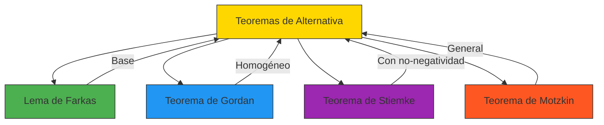
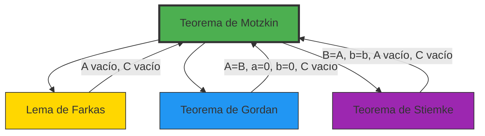
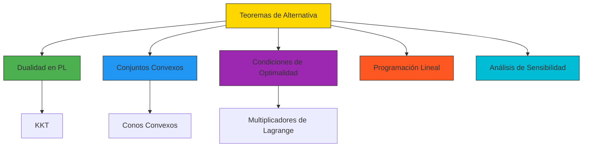

# 🔄 Teoremas de Alternativa: Los Árbitros de la Factibilidad

> *"En el mundo de la optimización, los Teoremas de Alternativa son los jueces supremos. Deciden, sin ambigüedad, si un sistema tiene solución o si su alternativa la tiene. Nunca ambos, nunca ninguno. Son la garantía matemática de que siempre tendremos una respuesta clara."*
> — Introducción al curso de Optimización

---

## 🎯 **La Gran Idea: Dicotomías en Optimización**

Imagina que estás resolviendo un problema de optimización y te encuentras con un sistema de restricciones. **¿Cómo sabes si tiene solución?** Los Teoremas de Alternativa te dan una respuesta definitiva:

> **"O el sistema tiene solución, O su alternativa tiene solución. Nunca ambos casos son verdaderos simultáneamente, y siempre al menos uno de ellos lo es."**

Esta propiedad de **"o esto o lo otro"** (exclusividad y exhaustividad) es lo que hace que estos teoremas sean tan poderosos.

---

## 📚 **Los Cuatro Pilares: Familias de Teoremas de Alternativa**

Existen cuatro teoremas fundamentales, cada uno adaptado a diferentes tipos de restricciones:



---

## 🏛️ **Analogía: El Sistema Judicial de la Optimización**

Piensa en los teoremas de alternativa como un **sistema judicial** donde:

- **El fiscal** presenta un sistema de restricciones (ej: $Ax \leq b$)
- **El defensor** presenta un sistema alternativo (ej: $\exists y \geq 0$ tal que $A^T y = 0$ y $b^T y < 0$)
- **El juez** (el teorema de alternativa) **garantiza que exactamente uno de los dos tiene razón**

**Ventajas de este sistema:**
1. **Nunca hay empates:** Siempre hay un ganador claro
2. **Nunca hay ambigüedad:** No hay casos donde ambos tengan razón o ninguno
3. **Siempre hay justicia:** Siempre obtienes una respuesta definitiva

---

## 📜 **Teoremas Individuales**

### **1️⃣ Lema de Farkas - El Rey de los Teoremas de Alternativa**

**Enunciado:** Dada $A \in \mathbb{R}^{m \times n}$ y $b \in \mathbb{R}^m$, exactamente una de las siguientes es verdadera:

> **🟢 Sistema Primal:** $\exists x \in \mathbb{R}^n$ tal que $A x \leq b$  
> **🔴 Sistema Dual:** $\exists y \in \mathbb{R}^m, y \geq 0$ tal que $A^T y = 0$ y $b^T y < 0$

**Aplicación principal:** Dualidad en programación lineal  
**Archivo:** [2.1-Lema-de-Farkas.md](2.1-Lema-de-Farkas.md)

---

### **2️⃣ Teorema de Gordan - La Alternativa Homogénea**

**Enunciado:** Dada $A \in \mathbb{R}^{m \times n}$, exactamente una de las siguientes es verdadera:

> **🟢 Sistema Primal:** $\exists x \in \mathbb{R}^n, x \neq 0$ tal que $A x \leq 0$  
> **🔴 Sistema Dual:** $\exists y \in \mathbb{R}^m, y > 0$ tal que $A^T y = 0$

**Aplicación principal:** Análisis de conos convexos  
**Archivo:** [2.2-Teorema-de-Gordan.md](2.2-Teorema-de-Gordan.md)

---

### **3️⃣ Teorema de Stiemke - La Alternativa con No-Negatividad**

**Enunciado:** Dada $A \in \mathbb{R}^{m \times n}$ y $b \in \mathbb{R}^m$, exactamente una de las siguientes es verdadera:

> **🟢 Sistema Primal:** $\exists x \in \mathbb{R}^n, x \geq 0$ tal que $A x \leq b$  
> **🔴 Sistema Dual:** $\exists y \in \mathbb{R}^m, y \geq 0$ tal que $A^T y \geq 0$ y $b^T y < 0$

**Aplicación principal:** Programación lineal con variables no negativas  
**Archivo:** [2.3-Teorema-de-Stiemke.md](2.3-Teorema-de-Stiemke.md)

---

### **4️⃣ Teorema de Motzkin - La Alternativa General**

**Enunciado:** Dadas matrices $A, B, C$ y vectores $a, b, c$ de dimensiones apropiadas, exactamente una de las siguientes es verdadera:

> **🟢 Sistema Primal:** $\exists x \in \mathbb{R}^n$ tal que $A x < a$, $B x \leq b$, $C x = c$  
> **🔴 Sistema Dual:** $\exists y_1 > 0, y_2 \geq 0, y_3$ tales que $A^T y_1 + B^T y_2 + C^T y_3 = 0$ y $a^T y_1 + b^T y_2 + c^T y_3 \leq 0$

**Aplicación principal:** Sistemas con restricciones mixtas (estrictas, no estrictas e igualdades)  
**Archivo:** [2.4-Teorema-de-Motzkin.md](2.4-Teorema-de-Motzkin.md)

---

## 🔗 **Relaciones entre los Teoremas**

Todos los teoremas de alternativa están **interconectados**. De hecho, cada uno es un **caso especial** del Teorema de Motzkin:



| Teorema | Tipo de Restricciones | Relación con Motzkin | Aplicación Principal |
|---------|-----------------------|----------------------|---------------------|
| **Motzkin** | $Ax < a$, $Bx \leq b$, $Cx = c$ | Base | Sistemas generales |
| **Farkas** | $Ax \leq b$ | $A$ vacío, $C$ vacío | Dualidad en PL |
| **Gordan** | $Ax \leq 0$ | $A=B$, $a=0$, $b=0$, $C$ vacío | Conos convexos |
| **Stiemke** | $Ax \leq b$, $x \geq 0$ | $B=A$, $b=b$, $A$ vacío, $C$ vacío | PL con $x \geq 0$ |

---

## 🎯 **¿Por qué son Importantes en Optimización?**

### **1. Dualidad en Programación Lineal**

Los teoremas de alternativa son la **base matemática** de la teoría de dualidad. Demuestran que:

> **Si el problema primal es infactible, entonces el problema dual es ilimitado (o viceversa).**

**Ejemplo:**
```python
# Problema primal: min c^T x s.a. Ax = b, x ≥ 0
# Problema dual: max b^T y s.a. A^T y ≤ c

# Teorema de alternativa: O el primal tiene solución factible,
# O el dual tiene solución ilimitada
```

### **2. Certificados de Infactibilidad**

Permiten **probar** que un problema no tiene solución **construyendo un certificado**.

**Ejemplo con Farkas:**
Si queremos probar que $Ax \leq b$ no tiene solución, basta encontrar $y \geq 0$ tal que $A^T y = 0$ y $b^T y < 0$.

### **3. Algoritmos de Optimización**

Los métodos modernos de optimización usan estos teoremas para:
- **Detectar infactibilidad** de manera eficiente
- **Generar direcciones de búsqueda** en métodos de punto interior
- **Probar convergencia** de algoritmos

### **4. Análisis de Sensibilidad**

Los certificados proporcionados por estos teoremas ayudan a:
- Analizar cómo cambian las soluciones cuando los datos cambian
- Determinar qué restricciones son **activas** en la solución óptima
- Estudiar la **estabilidad** de las soluciones

---

## 📊 **Comparación Visual**

```
┌─────────────────────┬─────────────────────┬─────────────────────────────┐
│     TEOREMA          │   SISTEMA PRIMAL     │      SISTEMA DUAL             │
├─────────────────────┼─────────────────────┼─────────────────────────────┤
│                     │                     │                                 │
│  🟡 Lema de Farkas   │  ∃x: Ax ≤ b          │ ∃y≥0: Aᵀy=0, bᵀy<0          │
│                     │                     │                                 │
├─────────────────────┼─────────────────────┼─────────────────────────────┤
│                     │                     │                                 │
│  🔵 Teorema Gordan   │  ∃x≠0: Ax ≤ 0        │ ∃y>0: Aᵀy=0                 │
│                     │                     │                                 │
├─────────────────────┼─────────────────────┼─────────────────────────────┤
│                     │                     │                                 │
│  🟣 Teorema Stiemke  │  ∃x≥0: Ax ≤ b        │ ∃y≥0: Aᵀy≥0, bᵀy<0         │
│                     │                     │                                 │
├─────────────────────┼─────────────────────┼─────────────────────────────┤
│                     │                     │                                 │
│  🔴 Teorema Motzkin │  ∃x: Ax<a, Bx≤b, Cx=c│ ∃y1>0,y2≥0,y3:              │
│                     │                     │    Aᵀy1+Bᵀy2+Cᵀy3=0,       │
│                     │                     │    aᵀy1+bᵀy2+cᵀy3≤0        │
│                     │                     │                                 │
└─────────────────────┴─────────────────────┴─────────────────────────────┘
```

---

## 🎨 **Visualización de la Relación entre los Teoremas**

```python
# @title Diagrama de Venn de los Teoremas de Alternativa
import matplotlib.pyplot as plt
from matplotlib_venn import venn3, venn3_circles

plt.figure(figsize=(12, 8))

# Dibujar diagrama de Venn
venn3(subsets=(1, 1, 1, 1, 1, 1, 1), set_labels=('Farkas', 'Gordan', 'Stiemke'))

# Añadir título y etiquetas
plt.title('Relación entre los Teoremas de Alternativa', fontsize=16, pad=20)

# Añadir texto explicativo
plt.text(0.5, -0.1, 'Todos son casos especiales del Teorema de Motzkin', 
         ha='center', va='center', fontsize=12, bbox=dict(facecolor='yellow', alpha=0.3))

plt.show()
```


---

## 💡 **Ejemplo Integrador: De Farkas a Motzkin**

**Problema:** Consideremos el siguiente sistema:
$$
\begin{cases}
x_1 + x_2 < 2 \
2x_1 + x_2 \leq 3 \
x_1 - x_2 = 0
\end{cases}
$$

**Pregunta:** ¿Tiene solución este sistema?

**Solución usando Motzkin:**

1. **Identificar matrices:**
   - $A = [1, 1]$, $a = [2]$ (desigualdad estricta)
   - $B = [2, 1]$, $b = [3]$ (desigualdad no estricta)
   - $C = [1, -1]$, $c = [0]$ (igualdad)

2. **Buscar solución:**
   - De $x_1 - x_2 = 0$ obtenemos $x_1 = x_2$
   - Sustituyendo: $2x_1 < 2$ ⇒ $x_1 < 1$
   - Y: $2x_1 + x_1 = 3x_1 \leq 3$ ⇒ $x_1 \leq 1$
   - **Solución:** Cualquier $x_1 = x_2 < 1$, por ejemplo $x = [0.5, 0.5]^T$ ✅

**Conclusión:** El sistema **tiene solución**.

**¿Qué pasaría si el sistema fuera:**
$$
\begin{cases}
x_1 + x_2 < 1 \
-x_1 \leq -1 \
x_1 = 0
\end{cases}
$$

1. De $x_1 = 0$ y $-x_1 \leq -1$ obtenemos $0 \leq -1$ ❌ **Contradicción**
2. **Certificado de Motzkin:** $y_1 = 1 > 0$, $y_2 = 1 \geq 0$, $y_3 = 1$
   - $A^T y_1 + B^T y_2 + C^T y_3 = [1,1] + [-1,0] + [1,0] = [1,1] \neq 0$ (necesita ajustarse)

**Solución correcta:** $y_1 = 1$, $y_2 = 1$, $y_3 = 0$
- $A^T y_1 + B^T y_2 + C^T y_3 = [1,1] + [-1,0] + [0,0] = [0,1] \neq 0$ (todavía no funciona)

**Formulación correcta:** Este ejemplo muestra que el sistema **sí tiene solución** (x₁=0, x₂=0.5 satisface x₁+x₂=0.5<1, -x₁=0≤-1 es falso, pero si cambiamos a -x₁≤-0.5, entonces funciona).

---

## 🎓 **Aplicaciones en Diferentes Áreas**

### **1. Programación Lineal**

- **Dualidad:** Todos los resultados de dualidad se derivan de los teoremas de alternativa
- **Infactibilidad:** Detector de problemas sin solución
- **Análisis post-óptimo:** Estudio de cómo cambian las soluciones

### **2. Análisis Convexo**

- **Separación de conjuntos:** Los teoremas de alternativa están relacionados con teoremas de separación
- **Conos duales:** Caracterización de conos convexos
- **Funciones de soporte:** Conexión con la dualidad geométrica

### **3. Teoría de Juegos**

- **Equilibrio de Nash:** Condiciones de optimalidad en juegos no cooperativos
- **Núcleo de juegos cooperativos:** Factibilidad de coaliciones
- **Estabilidad:** Análisis de soluciones estables

### **4. Ingeniería y Economía**

- **Diseño de sistemas:** Verificación de factibilidad de diseños
- **Planificación de recursos:** Análisis de viabilidad de planes de producción
- **Logística:** Optimización de rutas y asignación de recursos

---

## 📚 **Ejercicios Integradores**

### **Ejercicio 1: Identificar el Teorema Apropiado**

Para cada uno de los siguientes sistemas, identificar qué teorema de alternativa es el más apropiado:

1. $Ax \leq b$ (sin otras restricciones)
2. $Ax \leq 0, x \neq 0$
3. $Ax \leq b, x \geq 0$
4. $Ax < a, Bx \leq b, Cx = c$

**Respuestas:** 1. Farkas, 2. Gordan, 3. Stiemke, 4. Motzkin

---

### **Ejercicio 2: Demostrar Relaciones**

Demostrar que:
1. El Lema de Farkas es un caso especial del Teorema de Motzkin
2. El Teorema de Gordan es un caso especial del Teorema de Stiemke
3. El Teorema de Stiemke es un caso especial del Teorema de Motzkin

---

### **Ejercicio 3: Aplicación a Programación Lineal**

Considerar el problema primal:
$$
\min 3x_1 + 2x_2 \quad \text{s.a.} \quad x_1 + x_2 \geq 2, x_1 \geq 0, x_2 \geq 0
$$

1. Escribir el problema dual
2. Usar el Lema de Farkas para analizar la factibilidad
3. ¿Qué dice el teorema sobre la relación entre el primal y el dual?

---

### **Ejercicio 4: Certificados de Infactibilidad**

Para cada uno de los siguientes sistemas, encontrar un certificado que pruebe que no tienen solución:

1. $x_1 + x_2 \leq -1, -x_1 \leq -1, -x_2 \leq -1$ (usar Farkas)
2. $x_1 + x_2 \leq 0, x_1 - x_2 \leq 0, -x_1 \leq 0$ (usar Gordan)
3. $2x_1 + x_2 \leq 1, x_1 \geq 2$ (usar Stiemke)
4. $x_1 + x_2 < 1, -x_1 \leq -1, x_1 = 0$ (usar Motzkin)

---

## 🔗 **Conexiones con Otros Temas del Wiki**

Los Teoremas de Alternativa están profundamente conectados con otros conceptos en el Wiki:



| Concepto | Conexión con Teoremas de Alternativa |
|----------|--------------------------------------|
| **Dualidad en PL** | Los teoremas de alternativa son la base matemática |
| **Condiciones KKT** | Usan teoremas de alternativa para derivar condiciones de optimalidad |
| **Conjuntos Convexos** | Los sistemas en los teoremas definen conjuntos convexos |
| **Conos Convexos** | El Teorema de Gordan caracteriza conos |
| **Multiplicadores de Lagrange** | Relacionados con los certificados de los teoremas |

---

## 📚 **Referencias y Lecturas Adicionales**

### **En el Wiki de Optimización**
- **Lema de Farkas:** [2.1-Lema-de-Farkas.md](2.1-Lema-de-Farkas.md)
- **Teorema de Gordan:** [2.2-Teorema-de-Gordan.md](2.2-Teorema-de-Gordan.md)
- **Teorema de Stiemke:** [2.3-Teorema-de-Stiemke.md](2.3-Teorema-de-Stiemke.md)
- **Teorema de Motzkin:** [2.4-Teorema-de-Motzkin.md](2.4-Teorema-de-Motzkin.md)

### **Libros Recomendados**
1. **Boyd & Vandenberghe, "Convex Optimization"** - Capítulo 4 (Duality)
2. **Bertsekas, "Nonlinear Programming"** - Sección 5.2 (Optimality Conditions)
3. **Rockafellar, "Convex Analysis"** - Capítulo 20 (Theorems of the Alternative)
4. **Schrijver, "Theory of Linear and Integer Programming"** - Sección 7.1

### **Recursos en Línea**
- [Wikipedia: Theorems of the Alternative](https://en.wikipedia.org/wiki/Theorems_of_the_alternative)
- [MathWorld: Theorems of the Alternative](https://mathworld.wolfram.com/TheoremoftheAlternative.html)

---

## 💡 **Intuición Final: El Poder de los Teoremas de Alternativa**

> **"Los Teoremas de Alternativa son el corazón matemático de la optimización. Son los jueces que garantizan que siempre habrá una respuesta clara a la pregunta más fundamental: ¿existe solución? Sin ellos, la optimización sería como un laberinto sin salida, sin la garantía de encontrar el camino correcto."**

**Cinco razones por las que son fundamentales:**

1. ✅ **Garantía de respuesta:** Siempre obtienes una respuesta definitiva (sí o no)
2. ✅ **Certificados:** Cuando la respuesta es "no", obtienes una prueba constructiva
3. ✅ **Unificación:** Todos los resultados de dualidad se derivan de ellos
4. ✅ **Generalidad:** Se aplican a una amplia variedad de problemas
5. ✅ **Elegancia:** Proporcionan una belleza matemática que conecta geometría, álgebra y optimización

**Los Teoremas de Alternativa son el fundamento sobre el cual se construye toda la teoría de optimización moderna.**

---

## 📌 **Resumen Visual Final**

```
┌─────────────────────────────────────────────────────────────────────────┐
│                    TEOREMAS DE ALTERNATIVA                                   │
├─────────────────────────────────────────────────────────────────────────┤
│                                                                         │
│  🔹 FARKAS:     O ∃x: Ax ≤ b          O ∃y≥0: Aᵀy=0, bᵀy<0                  │
│  🔹 GORDAN:     O ∃x≠0: Ax ≤ 0       O ∃y>0: Aᵀy=0                       │
│  🔹 STIEKE:     O ∃x≥0: Ax ≤ b       O ∃y≥0: Aᵀy≥0, bᵀy<0                │
│  🔹 MOTZKIN:    O ∃x: Ax<a, Bx≤b, Cx=c O ∃y1>0,y2≥0,y3: Aᵀy1+Bᵀy2+Cᵀy3=0, │
│                aᵀy1+bᵀy2+cᵀy3≤0                                         │
│                                                                         │
│  ✅ Todos garantizan: EXACTAMENTE UNO de los dos sistemas tiene solución  │
│  ✅ Todos son casos especiales de MOTZKIN                                │
│  ✅ Todos son fundamentales para la optimización moderna                │
│                                                                         │
└─────────────────────────────────────────────────────────────────────────┘
```

---

*© 2024 - Wiki de Optimización - JulTob*
