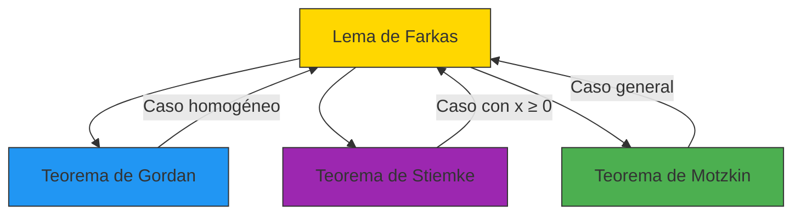

# 🏛️ Lema de Farkas: El Juez de la Factibilidad

> *"En el mundo de la optimización, el Lema de Farkas es el árbitro supremo: cuando un sistema de desigualdades no tiene solución, este lema te dice exactamente cómo probarlo."*
> — Adaptación para el curso de Optimización

---

## 🎯 **La Gran Pregunta: ¿Existe Solución?**

Imagina que tienes un sistema de restricciones lineales:
$$
\begin{cases}
2x_1 + x_2 \leq 5 \
-x_1 + 3x_2 \leq 2 \
x_1 \geq 0, x_2 \geq 0
\end{cases}
$$

**Pregunta:** ¿Cómo sabes si este sistema tiene solución?  
**Respuesta del Lema de Farkas:** Si no tiene solución, existe un **certificado** que lo prueba.

---

## 📜 **Enunciado Formal del Lema de Farkas**

Dada una matriz $A \in \mathbb{R}^{m \times n}$ y un vector $b \in \mathbb{R}^m$, **exactamente una** de las siguientes afirmaciones es verdadera:

> **🟢 Sistema Primal (Factibilidad):**
> $$
> \exists x \in \mathbb{R}^n \text{ tal que } A x \leq b
> $$

> **🔴 Sistema Dual (Certificado de Infactibilidad):**
> $$
> \exists y \in \mathbb{R}^m, y \geq 0 \text{ tal que } A^T y = 0 \text{ y } b^T y < 0
> $$

**Interpretación:** O el sistema tiene solución, **o** existe un vector $y \geq 0$ que **certifica** que no hay solución.

---

## 🎨 **Interpretación Geométrica: El Poliedro Vacío**

```mermaid
graph TD
    A[¿El poliedro {x | Ax ≤ b} es no vacío?] -->|Sí| B[✅ Tiene solución]
    A -->|No| C[❌ No tiene solución]
    C --> D[∃ y ≥ 0: Aᵀy = 0, bᵀy < 0]
    
    style B fill:#4CAF50,stroke:#333
    style D fill:#F44336,stroke:#333
```

**Visualización:**
- **Si el poliedro es no vacío:** Hay al menos un punto que satisface todas las restricciones
- **Si el poliedro es vacío:** No hay ningún punto que satisfaga todas las restricciones simultáneamente
- **El lema de Farkas:** Proporciona un **certificado** (el vector $y$) que prueba la vacuidad

### 🖼️ Ejemplo Visual en 2D

```python
# @title Visualización del Lema de Farkas
import numpy as np
import matplotlib.pyplot as plt
from matplotlib.patches import Polygon

def plot_farkas_example(system_type='con_solucion'):
    fig, ax = plt.subplots(figsize=(10, 8))
    
    x = np.linspace(-5, 5, 400)
    
    if system_type == 'con_solucion':
        # Sistema con solución: x1 + x2 ≤ 2, -x1 + 2x2 ≤ 2, x1 ≥ 0, x2 ≥ 0
        ax.plot(x, 2 - x, 'r--', label=r'$x_1 + x_2 \leq 2$')
        ax.plot(x, (2 + x)/2, 'g--', label=r'$-x_1 + 2x_2 \leq 2$')
        ax.axvline(0, color='b', linestyle='--', label=r'$x_1 \geq 0$')
        ax.axhline(0, color='m', linestyle='--', label=r'$x_2 \geq 0$')
        
        # Región factible
        y1 = np.minimum(2 - x, (2 + x)/2)
        y1 = np.maximum(y1, 0)
        ax.fill_between(x, 0, y1, where=(x >= 0) & (y1 >= 0), 
                       color='lightblue', alpha=0.5, label='Región factible')
        
        # Solución
        ax.scatter([0.5, 1], [1.5, 0.5], color='green', s=100, zorder=5)
        ax.set_title('✅ Sistema CON Solución (Poliedro no vacío)', color='green')
        
    else:
        # Sistema sin solución: x1 + x2 ≤ -1, -x1 ≤ -1, -x2 ≤ -1
        ax.plot(x, -1 - x, 'r--', label=r'$x_1 + x_2 \leq -1$')
        ax.plot(x, -1 * np.ones_like(x), 'g--', label=r'$x_1 \geq 1$')
        ax.plot(x, -1 * np.ones_like(x), 'b--', label=r'$x_2 \geq 1$')
        
        # No hay región factible
        ax.set_title('❌ Sistema SIN Solución (Poliedro vacío)', color='red')
        
        # Certificado de Farkas: y = [1, 1, 1]
        # Aᵀy = [1-1, 1-1] = [0, 0]
        # bᵀy = -1 -1 -1 = -3 < 0
        ax.text(0, 3, 'Certificado de Farkas: y = [1, 1, 1]\nAᵀy = [0, 0], bᵀy = -3 < 0', 
                ha='center', va='center', bbox=dict(facecolor='yellow', alpha=0.5))
    
    ax.set_xlim(-3, 3)
    ax.set_ylim(-3, 4)
    ax.set_xlabel('$x_1$')
    ax.set_ylabel('$x_2$')
    ax.grid(True, alpha=0.3)
    ax.legend()
    ax.set_aspect('equal')
    
    plt.tight_layout()
    plt.show()

# Descomentar para ejecutar:
# plot_farkas_example('con_solucion')
# plot_farkas_example('sin_solucion')
```


---

## 🧮 **Ejemplo Paso a Paso**

### **Problema:** Demostrar que el siguiente sistema no tiene solución:
$$
\begin{cases}
x_1 + x_2 \leq -1 \
-x_1 \leq -1 \
-x_2 \leq -1
\end{cases}
$$

### **Solución usando el Lema de Farkas:**

**Paso 1:** Identificar $A$ y $b$
$$
A = \begin{bmatrix}1 & 1 \\ -1 & 0 \\ 0 & -1\end{bmatrix}, \quad b = \begin{bmatrix}-1 \\ -1 \\ -1\end{bmatrix}
$$

**Paso 2:** Buscar $y = [y_1, y_2, y_3]^T \geq 0$ tal que:
$$
A^T y = 0 \quad \text{y} \quad b^T y < 0
$$

**Paso 3:** Escribir las ecuaciones:
$$
\begin{cases}
y_1 - y_2 = 0 \
y_1 - y_3 = 0 \
-y_1 - y_2 - y_3 < 0
\end{cases}
$$

**Paso 4:** Resolver:
- De $y_1 = y_2$ y $y_1 = y_3$, tenemos $y_1 = y_2 = y_3$
- Sustituyendo en la desigualdad: $-y_1 - y_1 - y_1 = -3y_1 < 0$ ⇒ $y_1 > 0$

**Paso 5:** Elegir $y_1 = y_2 = y_3 = 1$ (por ejemplo)

**Verificación:**
- $A^T y = [1-1, 1-1]^T = [0, 0]^T$ ✅
- $b^T y = -1 -1 -1 = -3 < 0$ ✅

**Conclusión:** El sistema no tiene solución, y $y = [1, 1, 1]^T$ es un **certificado de Farkas**.

---

## 🔗 **Conexión con la Dualidad en Programación Lineal**

El Lema de Farkas es la **piedra angular** de la teoría de dualidad en programación lineal.

### **Teorema de Dualidad Fuerte**

Consideremos el problema primal:
$$
\begin{align*}
\min & \quad c^T x \\
\text{s.a.} & \quad A x \leq b
\end{align*}
$$

Y su problema dual:
$$
\begin{align*}
\max & \quad b^T y \\
\text{s.a.} & \quad A^T y = c \\
& \quad y \geq 0
\end{align*}
$$

**El Lema de Farkas implica:**
> **O el problema primal tiene solución óptima, O el problema dual es ilimitado.**

**Corolario:** Si ambos problemas son factibles, entonces ambos tienen soluciones óptimas y los valores óptimos coinciden.

### **Demostración Intuitiva**

1. **Si el primal tiene solución óptima $x^*$:**
   - El valor óptimo es $c^T x^*$
   - Para cualquier $y$ factible del dual: $b^T y \leq c^T x^*$ (por el lema de Farkas)
   - El dual está acotado superiormente por $c^T x^*$

2. **Si el primal es infactible:**
   - Por Farkas, existe $y \geq 0$ tal que $A^T y = 0$ y $b^T y < 0$
   - Este $y$ puede usarse para construir una solución ilimitada del dual

---

## 💡 **Aplicaciones Prácticas**

### **1. Detección de Infactibilidad**

En algoritmos de optimización, el Lema de Farkas permite:
- **Probar que un problema no tiene solución** sin tener que buscarla
- **Generar certificados de infactibilidad** para análisis de sensibilidad

**Ejemplo en código:**

```python
# @title Verificación de factibilidad usando Farkas (simplificado)
import numpy as np
from scipy.optimize import linprog

def check_feasibility_with_farkas(A, b):
    """
    Verifica factibilidad usando el Lema de Farkas
    (Implementación simplificada para demostración)
    """
    # Intentar resolver el sistema Ax <= b
    res = linprog(c=np.zeros(A.shape[1]), A_ub=A, b_ub=b, 
                  bounds=(None, None), method='highs')
    
    if res.success:
        print("✅ Sistema tiene solución:", res.x)
        return True
    else:
        print("❌ Sistema NO tiene solución")
        # En un implementación completa, buscaríamos y >= 0 tal que Aᵀy = 0 y bᵀy < 0
        # Aquí solo mostramos el mensaje
        return False

# Ejemplo 1: Sistema con solución
A1 = np.array([[1, 1], [-1, 2]])
b1 = np.array([2, 1])
print("Ejemplo 1:")
check_feasibility_with_farkas(A1, b1)

# Ejemplo 2: Sistema sin solución
A2 = np.array([[1, 1], [-1, 0], [0, -1]])
b2 = np.array([-1, -1, -1])
print("\nEjemplo 2:")
check_feasibility_with_farkas(A2, b2)
```

---

## 📚 **Relación con Otros Teoremas de Alternativa**

El Lema de Farkas es el más importante de una familia de teoremas:



| Teorema | Relación con Farkas | Diferencia Principal |
|---------|---------------------|---------------------|
| **Farkas** | Base | $Ax \leq b$ vs $A^T y = 0, b^T y < 0$ |
| **Gordan** | Caso homogéneo ($b=0$) | $Ax \leq 0, x \neq 0$ vs $A^T y = 0, y > 0$ |
| **Stiemke** | Con variables no negativas | $Ax \leq b, x \geq 0$ vs $A^T y \geq 0, b^T y < 0, y \geq 0$ |
| **Motzkin** | Caso general | Combina desigualdades estrictas, no estrictas e igualdades |

---

## 🎓 **Ejercicios Propuestos**

### **Ejercicio 1: Aplicación Directa**

Demostrar usando el Lema de Farkas que el siguiente sistema no tiene solución:
$$
\begin{cases}
2x_1 + x_2 \leq -2 \
x_1 - x_2 \leq -1 \
x_1 \geq 0, x_2 \geq 0
\end{cases}
$$

**Pista:** Buscar $y = [y_1, y_2, y_3, y_4]^T \geq 0$ tal que...

---

### **Ejercicio 2: Conexión con Dualidad**

Considerar el problema primal:
$$
\min 3x_1 + 2x_2 \quad \text{s.a.} \quad x_1 + x_2 \geq 2, x_1 \geq 0, x_2 \geq 0
$$

1. Escribir el problema dual
2. Usar el Lema de Farkas para analizar la factibilidad
3. ¿Qué dice el lema sobre la relación entre el primal y el dual?

---

### **Ejercicio 3: Certificado de Infactibilidad**

Para el sistema:
$$
\begin{cases}
x_1 + x_2 \leq 1 \
2x_1 + x_2 \leq 1 \
-x_1 \leq -1 \
-x_2 \leq -1
\end{cases}
$$

Encontrar un certificado de Farkas $y \geq 0$ que pruebe que el sistema no tiene solución.

---

### **Ejercicio 4: Implementación Numérica**

Implementar una función en Python que:
1. Tome como entrada $A$ y $b$
2. Verifique si el sistema $Ax \leq b$ tiene solución
3. Si no tiene solución, intente encontrar un certificado de Farkas

**Pista:** Usar `scipy.optimize.linprog` para verificar factibilidad, y luego resolver el sistema dual para encontrar $y$.

---

## 🔗 **Referencias y Conexiones**

### **En el Wiki de Optimización**
- **Teoremas de Alternativa:** [2.0-Teoremas-de-Alternativa.md](2.0-Teoremas-de-Alternativa.md)
- **Dualidad en Programación Lineal:** [3.0-Dualidad.md](3.0-Dualidad.md) (próximamente)
- **Conjuntos Convexos:** [A.6-Conjunto-Factible.md](A.6-Conjunto-Factible.md)

### **Libros Recomendados**
1. **Boyd & Vandenberghe, "Convex Optimization"** - Capítulo 4 (Duality)
2. **Bertsekas, "Nonlinear Programming"** - Sección 5.2 (Optimality Conditions)
3. **Rockafellar, "Convex Analysis"** - Teorema 20.1 (Farkas' Lemma)

### **Recursos en Línea**
- [Wikipedia: Farkas' Lemma](https://en.wikipedia.org/wiki/Farkas%27_lemma)
- [MathWorld: Farkas' Lemma](https://mathworld.wolfram.com/FarkasLemma.html)

---

## 💡 **Intuición Final: El Poder del Lema de Farkas**

> **"El Lema de Farkas es como un detector de mentiras para sistemas de desigualdades: si un sistema afirma tener solución pero no la tiene, el lema te da la prueba para desenmascararlo."**

- **En optimización:** Es la base de la dualidad y los algoritmos de punto interior
- **En teoría:** Proporciona una caracterización elegante de la factibilidad
- **En práctica:** Permite detectar infactibilidad de manera eficiente

**El lema de Farkas es el puente entre la geometría de los poliedros y el álgebra de los sistemas lineales.**

---

## 📌 **Resumen Visual**

```
┌─────────────────────────────────────────────────────────────┐
│                    LEMA DE FARKAS                              │
├─────────────────────────────────────────────────────────────┤
│  Dada A ∈ ℝ^(m×n), b ∈ ℝ^m:                                │
│                                                             │
│  O el sistema Ax ≤ b TIENE solución                        │
│       (Poliedro no vacío)                                    │
│                                                             │
│  O existe y ≥ 0 tal que Aᵀy = 0 y bᵀy < 0                │
│       (Certificado de infactibilidad)                      │
│                                                             │
│  ✅ Nunca ambos, nunca ninguno                              │
└─────────────────────────────────────────────────────────────┘
```

---

*© 2024 - Wiki de Optimización - JulTob*
