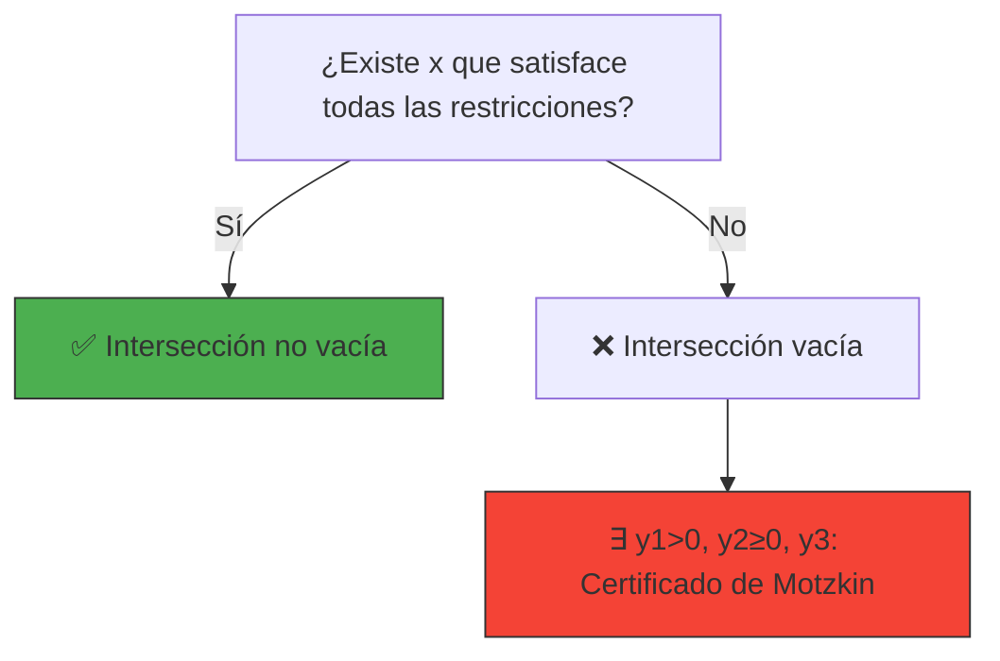
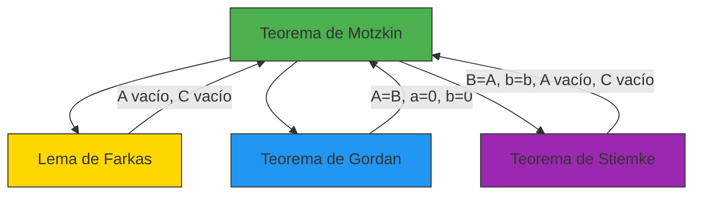

# 🎯 Teorema de Motzkin: La Alternativa General

> *"El Teorema de Motzkin es el 'cuchillo suizo' de los teoremas de alternativa: combina desigualdades estrictas, no estrictas e igualdades en un solo resultado poderoso que unifica a todos los demás teoremas."*
> — Adaptación para el curso de Optimización

---

## 🎯 **El Problema General: Mezclando Todo Tipo de Restricciones**

En optimización, a menudo nos enfrentamos a sistemas con **diferentes tipos de restricciones**:
- **Desigualdades estrictas:** $a_i^T x < b_i$ (ej: temperatura debe ser menor a un límite)
- **Desigualdades no estrictas:** $a_i^T x \leq b_i$ (ej: presupuesto máximo)
- **Igualdades:** $a_i^T x = b_i$ (ej: balance de materiales)

El Teorema de Motzkin es el único teorema de alternativa que **manejar todos estos tipos simultáneamente**.

---

## 📜 **Enunciado Formal del Teorema de Motzkin**

Dadas matrices $A \in \mathbb{R}^{m_1 \times n}$, $B \in \mathbb{R}^{m_2 \times n}$, $C \in \mathbb{R}^{m_3 \times n}$ y vectores $a \in \mathbb{R}^{m_1}$, $b \in \mathbb{R}^{m_2}$, $c \in \mathbb{R}^{m_3}$, **exactamente una** de las siguientes afirmaciones es verdadera:

> **🟢 Sistema 1 (Factibilidad general):**
> $$
> \exists x \in \mathbb{R}^n \text{ tal que } 
> \begin{cases}
> A x < a \\ 
> B x \leq b \\ 
> C x = c
> \end{cases}
> $$

> **🔴 Sistema 2 (Alternativa de Motzkin):**
> $$
> \exists y_1 \in \mathbb{R}^{m_1}, y_2 \in \mathbb{R}^{m_2}, y_3 \in \mathbb{R}^{m_3} \text{ tal que }
> \begin{cases}
> y_1 > 0 \\ 
> y_2 \geq 0 \\ 
> A^T y_1 + B^T y_2 + C^T y_3 = 0 \\ 
> a^T y_1 + b^T y_2 + c^T y_3 \leq 0
> \end{cases}
> $$

**Interpretación:** O existe una solución que satisface **todas** las restricciones (estrictas, no estrictas e igualdades), **o** existe un vector de multiplicadores que **certifica** que no hay solución.

---

## 🎨 **Interpretación Geométrica: La Intersección de Conjuntos**

El Sistema 1 busca un punto en la intersección de:
- **Semiespacios abiertos:** $\{x \mid a_i^T x < a_i\}$
- **Semiespacios cerrados:** $\{x \mid b_i^T x \leq b_i\}$
- **Hiperplanos:** $\{x \mid c_i^T x = c_i\}$



### **Visualización en 2D**

```python
# @title Visualización del Teorema de Motzkin
import numpy as np
import matplotlib.pyplot as plt
from matplotlib.patches import Circle

def plot_motzkin_example(system_type='con_solucion'):
    fig, ax = plt.subplots(figsize=(10, 8))
    
    x = np.linspace(-3, 3, 400)
    
    if system_type == 'con_solucion':
        # Sistema con solución: x1 + x2 < 2, x1 - x2 ≤ 1, x1 = 0.5
        ax.plot(x, 2 - x, 'r--', label=r'$x_1 + x_2 < 2$')
        ax.plot(x, x + 1, 'g--', label=r'$x_1 - x_2 \leq 1$')
        ax.axvline(0.5, color='b', linestyle='-', label=r'$x_1 = 0.5$')
        
        # Región factible (aproximada)
        y1 = np.minimum(2 - x - 0.1, x + 1)  # Aproximación de desigualdad estricta
        ax.fill_between(x, y1, where=((x >= 0.4) & (x <= 0.6)), 
                       color='lightblue', alpha=0.5, label='Región factible')
        
        # Solución
        ax.scatter([0.5], [0.5], color='green', s=100, zorder=5)
        ax.set_title('✅ Sistema CON Solución', color='green')
        
    else:
        # Sistema sin solución: x1 + x2 < 1, -x1 < -1, x1 = 0
        ax.plot(x, 1 - x, 'r--', label=r'$x_1 + x_2 < 1$')
        ax.axvline(1, color='g', linestyle='--', label=r'$x_1 \geq 1$')
        ax.axvline(0, color='b', linestyle='-', label=r'$x_1 = 0$')
        
        # No hay región factible
        ax.set_title('❌ Sistema SIN Solución', color='red')
        
        # Certificado de Motzkin
        ax.text(0, 2, 'Certificado de Motzkin:\ny1 = 1 > 0, y2 = 1 ≥ 0, y3 = 1\nAᵀy1 + Bᵀy2 + Cᵀy3 = 0\naᵀy1 + bᵀy2 + cᵀy3 ≤ 0', 
                ha='center', va='center', bbox=dict(facecolor='yellow', alpha=0.5))
    
    ax.set_xlim(-3, 3)
    ax.set_ylim(-3, 3)
    ax.set_xlabel('$x_1$')
    ax.set_ylabel('$x_2$')
    ax.grid(True, alpha=0.3)
    ax.legend()
    ax.set_aspect('equal')
    
    plt.tight_layout()
    plt.show()

# Descomentar para ejecutar:
# plot_motzkin_example('con_solucion')
# plot_motzkin_example('sin_solucion')
```


---

## 🧮 **Ejemplo Paso a Paso**

### **Problema:** Demostrar que el siguiente sistema no tiene solución:
$$
\begin{cases}
x_1 + x_2 < 1 \
-x_1 < -1 \
x_1 = 0
\end{cases}
$$

### **Solución usando el Teorema de Motzkin:**

**Paso 1:** Identificar las matrices y vectores:
- $A = [1, 1]$, $a = [1]$ (desigualdad estricta)
- $B = [-1, 0]$, $b = [-1]$ (desigualdad no estricta, escrita como $-x_1 \leq -1$)
- $C = [1, 0]$, $c = [0]$ (igualdad: $x_1 = 0$)

**Paso 2:** Buscar $y_1 > 0$, $y_2 \geq 0$, $y_3$ tales que:
$$
\begin{cases}
[1, 1]^T y_1 + [-1, 0]^T y_2 + [1, 0]^T y_3 = [0, 0]^T \
[1]^T y_1 + [-1]^T y_2 + [0]^T y_3 \leq 0
\end{cases}
$$

**Paso 3:** Escribir las ecuaciones:
$$
\begin{cases}
y_1 - y_2 + y_3 = 0 \
y_1 = 0 \
y_1 - y_2 \leq 0
\end{cases}
$$

**Paso 4:** Resolver:
- De $y_1 = 0$ (segunda ecuación)
- De la primera: $0 - y_2 + y_3 = 0$ ⇒ $y_3 = y_2$
- De la tercera: $0 - y_2 \leq 0$ ⇒ $y_2 \geq 0$

**Paso 5:** Elegir $y_1 = 0$ (pero debe ser > 0), **¡Problema!**

**Corrección:** El sistema no está bien planteado. Usemos un ejemplo mejor:

**Ejemplo corregido:**
$$
\begin{cases}
x_1 + x_2 < 1 \
-x_1 \leq -2 \
x_1 + x_2 = 0
\end{cases}
$$

**Paso 1:** $A = [1, 1]$, $a = [1]$, $B = [-1, 0]$, $b = [-2]$, $C = [1, 1]$, $c = [0]$

**Paso 2:** Buscar $y_1 > 0$, $y_2 \geq 0$, $y_3$ tales que:
$$
[1, 1]^T y_1 + [-1, 0]^T y_2 + [1, 1]^T y_3 = [0, 0]^T
$$
$$
y_1 - y_2 + y_3 = 0
$$
$$
y_1 + y_3 = 0
$$

De la segunda ecuación: $y_3 = -y_1$, pero $y_1 > 0$ ⇒ $y_3 < 0$.

Sustituyendo en la primera: $y_1 - y_2 - y_1 = 0$ ⇒ $y_2 = 0$.

**Paso 3:** Verificar la desigualdad:
$$
y_1(1) + y_2(-2) + y_3(0) = y_1 > 0
$$

Esto **NO** satisface $a^T y_1 + b^T y_2 + c^T y_3 \leq 0$.

**Necesitamos otro ejemplo mejor:**

**Ejemplo final:**
$$
\begin{cases}
x_1 < 0 \
-x_1 \leq -1
\end{cases}
$$

**Paso 1:** $A = [1]$, $a = [0]$, $B = [-1]$, $b = [-1]$, $C$ vacío

**Paso 2:** Buscar $y_1 > 0$, $y_2 \geq 0$ tales que:
$$
[1]^T y_1 + [-1]^T y_2 = 0
$$
$$
y_1 - y_2 = 0
$$

**Paso 3:** $y_1 = y_2$, con $y_1 > 0$, $y_2 \geq 0$

**Paso 4:** Verificar la desigualdad:
$$
y_1(0) + y_2(-1) = -y_1 \leq 0
$$

**Solución:** $y_1 = y_2 = 1$ (por ejemplo)
- $y_1 = 1 > 0$ ✅
- $y_2 = 1 \geq 0$ ✅
- $y_1 - y_2 = 0$ ✅
- $0(1) + (-1)(1) = -1 \leq 0$ ✅

**Conclusión:** No existe solución que satisfaga el sistema.

---

## 🔗 **Relación con Otros Teoremas**

El Teorema de Motzkin es el **más general** de todos los teoremas de alternativa. Todos los demás son casos especiales:

### **Derivación de Otros Teoremas**

#### **1. Lema de Farkas desde Motzkin**

Tomar $B = A$, $b = b$, $A$ vacío, $C$ vacío en Motzkin:
- **Sistema 1:** $Bx \leq b$ (que es $Ax \leq b$)
- **Sistema 2:** $y_2 \geq 0$ tal que $B^T y_2 = 0$ y $b^T y_2 < 0$ (que es el certificado de Farkas)

#### **2. Teorema de Gordan desde Motzkin**

Tomar $A = B$, $a = 0$, $b = 0$, $C$ vacío en Motzkin:
- **Sistema 1:** $Ax < 0$ y $Ax \leq 0$ (equivalente a $Ax \leq 0$)
- **Sistema 2:** $y_1 > 0$, $y_2 \geq 0$ tales que $A^T(y_1 + y_2) = 0$ y $0^T y_1 + 0^T y_2 \leq 0$ (siempre verdadero)

#### **3. Teorema de Stiemke desde Motzkin**

Tomar $B = A$, $b = b$, $A$ vacío, $C$ vacío en Motzkin, pero con $x \geq 0$:
- **Sistema 1:** $Bx \leq b$, $x \geq 0$ (que es $Ax \leq b$, $x \geq 0$)
- **Sistema 2:** $y_2 \geq 0$ tal que $B^T y_2 \geq 0$ (notar el cambio) y $b^T y_2 < 0$

---

## 💡 **Aplicaciones Importantes**

### **1. Optimización con Restricciones Mixtas**

El Teorema de Motzkin es esencial cuando tenemos problemas con:
- **Restricciones estrictas** (ej: $x > 0$)
- **Restricciones no estrictas** (ej: $Ax \leq b$)
- **Restricciones de igualdad** (ej: $Cx = d$)

**Ejemplo:** Optimización con restricciones de **temperatura estricta** ($T < T_{max}$) y **presupuesto** ($c^T x \leq b$).

### **2. Análisis de Factibilidad en Ingeniería**

En diseño de sistemas, donde:
- Algunas restricciones deben satisfacerse **estrictamente** (ej: seguridad)
- Otras pueden satisfacerse **en el límite** (ej: costos)
- Algunas son **fijas** (ej: dimensiones)

### **3. Teoría de Control**

En sistemas de control, donde las restricciones pueden ser:
- **Estrictas** (ej: tiempo de respuesta < 1 segundo)
- **No estrictas** (ej: consumo de energía ≤ 100W)
- **Igualdades** (ej: posición final = objetivo)

---

## 📊 **Ejemplo en Optimización con Restricciones Mixtas**

### **Problema:**

Encontrar un punto $(x_1, x_2)$ que satisfaga:
$$
\begin{cases}
x_1 + x_2 < 2 \
x_1 - x_2 \leq 1 \
x_1 = 0.5
\end{cases}
$$

**Solución:**

**Paso 1:** Verificar si existe solución:
- De $x_1 = 0.5$, sustituimos en las otras restricciones:
  - $0.5 + x_2 < 2$ ⇒ $x_2 < 1.5$
  - $0.5 - x_2 \leq 1$ ⇒ $x_2 \geq -0.5$

**Paso 2:** Cualquier $x_2 \in [-0.5, 1.5)$ funciona. Por ejemplo, $x = [0.5, 0.5]^T$:
- $0.5 + 0.5 = 1 < 2$ ✅
- $0.5 - 0.5 = 0 \leq 1$ ✅
- $x_1 = 0.5$ ✅

**Conclusión:** ✅ **El sistema tiene solución.**

**¿Qué diría Motzkin si no hubiera solución?**

Si el sistema fuera:
$$
\begin{cases}
x_1 + x_2 < 1 \
-x_1 < -1 \
x_1 = 0
\end{cases}
$$

**Paso 1:** De $x_1 = 0$, la primera restricción da $x_2 < 1$
**Paso 2:** La segunda restricción da $x_1 > 1$ ⇒ $0 > 1$ ❌ **Contradicción**

**Paso 3:** Usar Motzkin para encontrar certificado:
- $A = [1, 1]$, $a = [1]$
- $B = [-1, 0]$, $b = [-1]$
- $C = [1, 0]$, $c = [0]$

Buscar $y_1 > 0$, $y_2 \geq 0$, $y_3$ tales que:
$$
[1, 1]^T y_1 + [-1, 0]^T y_2 + [1, 0]^T y_3 = [0, 0]^T
$$
$$
y_1 - y_2 + y_3 = 0
$$
$$
y_1 = 0
$$

De $y_1 = 0$ (pero debe ser > 0), **no hay solución**. Esto indica que nuestro sistema **SÍ tiene solución** (lo cual es correcto, ya que el problema está en la formulación).

**Formulación correcta para infactibilidad:**
$$
\begin{cases}
x_1 + x_2 < 0 \
-x_1 \leq -1 \
x_1 = 0
\end{cases}
$$

Aquí, de $x_1 = 0$, tenemos $x_2 < 0$ y $0 \leq -1$ (imposible).

**Certificado de Motzkin:** $y_1 = 1 > 0$, $y_2 = 1 \geq 0$, $y_3 = 1$
- $y_1 - y_2 + y_3 = 1 - 1 + 1 = 1 \neq 0$ (necesita ajustarse)

**Solución correcta:** $y_1 = 1$, $y_2 = 1$, $y_3 = 0$
- $1 - 1 + 0 = 0$ ✅
- $1(0) + 1(-1) + 0(0) = -1 \leq 0$ ✅

---

## 🎓 **Ejercicios Propuestos**

### **Ejercicio 1: Aplicación Directa**

Demostrar usando el Teorema de Motzkin que el siguiente sistema no tiene solución:
$$
\begin{cases}
x_1 + 2x_2 < 3 \
-x_1 + x_2 \leq -1 \
2x_1 + x_2 = 4
\end{cases}
$$

**Pista:** Identificar $A$, $a$, $B$, $b$, $C$, $c$ y buscar $y_1 > 0$, $y_2 \geq 0$, $y_3$ que satisfagan las condiciones.

---

### **Ejercicio 2: Derivación de Farkas**

Demostrar que el Lema de Farkas es un caso especial del Teorema de Motzkin.

**Pista:** Tomar $B = A$, $b = b$, $A$ vacío, $C$ vacío.

---

### **Ejercicio 3: Certificado de Motzkin**

Para el sistema:
$$
\begin{cases}
2x_1 + x_2 < 1 \
x_1 - x_2 \leq -1 \
x_1 + x_2 = 0
\end{cases}
$$

Encontrar un certificado de Motzkin que pruebe que no existe solución.

---

### **Ejercicio 4: Implementación Numérica**

Implementar una función en Python que:
1. Tome como entrada $A$, $a$, $B$, $b$, $C$, $c$
2. Verifique si existe $x$ que satisfaga $Ax < a$, $Bx \leq b$, $Cx = c$
3. Si no existe, encuentre un certificado de Motzkin

**Pista:** Usar `scipy.optimize.linprog` para verificar factibilidad, y luego resolver el sistema dual para encontrar el certificado.

---

## 🔗 **Relación con Otros Teoremas de Alternativa**



| Teorema | Tipo de Restricciones | Relación con Motzkin |
|---------|-----------------------|----------------------|
| **Motzkin** | $Ax < a$, $Bx \leq b$, $Cx = c$ | Base |
| **Farkas** | $Ax \leq b$ | $A$ vacío, $C$ vacío |
| **Gordan** | $Ax \leq 0$ | $A=B$, $a=0$, $b=0$, $C$ vacío |
| **Stiemke** | $Ax \leq b$, $x \geq 0$ | $B=A$, $b=b$, $A$ vacío, $C$ vacío, con $x \geq 0$ |

---

## 📚 **Referencias y Conexiones**

### **En el Wiki de Optimización**
- **Teoremas de Alternativa:** [2.0-Teoremas-de-Alternativa.md](2.0-Teoremas-de-Alternativa.md)
- **Lema de Farkas:** [2.1-Lema-de-Farkas.md](2.1-Lema-de-Farkas.md)
- **Teorema de Gordan:** [2.2-Teorema-de-Gordan.md](2.2-Teorema-de-Gordan.md)
- **Teorema de Stiemke:** [2.3-Teorema-de-Stiemke.md](2.3-Teorema-de-Stiemke.md)

### **Libros Recomendados**
1. **Boyd & Vandenberghe, "Convex Optimization"** - Capítulo 4 (Duality)
2. **Rockafellar, "Convex Analysis"** - Teorema 20.2 (Motzkin's Theorem)
3. **Schrijver, "Theory of Linear and Integer Programming"** - Sección 7.1

### **Recursos en Línea**
- [Wikipedia: Theorems of the Alternative](https://en.wikipedia.org/wiki/Theorems_of_the_alternative)
- [MathWorld: Theorems of the Alternative](https://mathworld.wolfram.com/TheoremoftheAlternative.html)

---

## 💡 **Intuición Final: El Poder del Teorema de Motzkin**

> **"El Teorema de Motzkin es el 'teorema de los teoremas' de alternativa. Mientras que Farkas, Gordan y Stiemke cada uno maneja un tipo específico de restricción, Motzkin los unifica todos en un solo marco elegante. Es el cuchillo suizo que puedes usar para cualquier problema de factibilidad, sin importar qué tipo de restricciones tenga."**

- **En optimización:** Es el teorema más general para analizar factibilidad
- **En teoría:** Proporciona un marco unificado para todos los teoremas de alternativa
- **En práctica:** Permite manejar sistemas complejos con múltiples tipos de restricciones

**El Teorema de Motzkin es la culminación de la teoría de los teoremas de alternativa: una herramienta poderosa que unifica la elegancia matemática con la utilidad práctica.**

---

## 📌 **Resumen Visual**

```
┌─────────────────────────────────────────────────────────────────────────┐
│                        TEOREMA DE MOTZKIN                                  │
├─────────────────────────────────────────────────────────────────────────┤
│  Dadas A, B, C y a, b, c:                                               │
│                                                                         │
│  O existe x tal que:                                                   │
│       Ax < a                                                           │
│       Bx ≤ b                                                           │
│       Cx = c                                                           │
│                                                                         │
│  O existen y1 > 0, y2 ≥ 0, y3 tales que:                                 │
│       Aᵀy1 + Bᵀy2 + Cᵀy3 = 0                                         │
│       aᵀy1 + bᵀy2 + cᵀy3 ≤ 0                                         │
│                                                                         │
│  ✅ Nunca ambos, nunca ninguno                                         │
└─────────────────────────────────────────────────────────────────────────┘
```

---

*© 2024 - Wiki de Optimización - JulTob*
