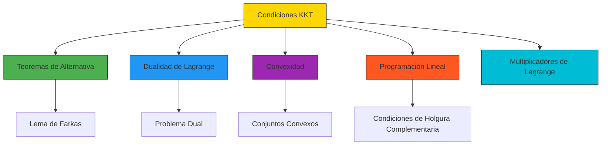

# 🎯 Condiciones KKT: Las Reglas de Oro de la Optimización

> *"Las condiciones KKT son el 'Santo Grial' de la optimización con restricciones. Son las condiciones necesarias y, bajo convexidad, suficientes para que un punto sea óptimo. Son el puente entre el cálculo diferencial y la optimización aplicada."*
> — Introducción al curso de Optimización

---

## 🎯 **La Gran Pregunta: ¿Cómo Encontrar el Óptimo con Restricciones?**

Imagina que quieres maximizar el beneficio de una empresa, pero tienes restricciones:
- **Presupuesto limitado**
- **Capacidad de producción limitada**
- **Demanda mínima que satisfacer**

**¿Cómo encuentras el punto óptimo que maximiza el beneficio respetando todas las restricciones?**

Las **Condiciones de Karush-Kuhn-Tucker (KKT)** son la respuesta.

---

## 📜 **Enunciado de las Condiciones KKT**

Consideremos el problema de optimización con restricciones:

$$
\begin{align*}
\min_{x \in \mathbb{R}^n} & \quad f(x) \\
\text{s.a.} & \quad g_i(x) \leq 0, \quad i = 1, \dots, m \\
& \quad h_j(x) = 0, \quad j = 1, \dots, p
\end{align*}
$$

**Las Condiciones KKT afirman que:**

Si $x^*$ es un **punto factible** y un **óptimo local** del problema, y las funciones $f$, $g_i$, $h_j$ son **diferenciables** en $x^*$, entonces existen multiplicadores $\lambda \in \mathbb{R}^m$ y $\mu \in \mathbb{R}^p$ tales que:

> **1. Condición de Estacionariedad (Gradientes Nulos):**
> $$
> \nabla f(x^*) + \sum_{i=1}^m \lambda_i \nabla g_i(x^*) + \sum_{j=1}^p \mu_j \nabla h_j(x^*) = 0
> $$

> **2. Condiciones de Factibilidad Primal:**
> $$
> g_i(x^*) \leq 0, \quad i = 1, \dots, m \\
> h_j(x^*) = 0, \quad j = 1, \dots, p
> $$

> **3. Condiciones de Complementariedad:**
> $$
> \lambda_i g_i(x^*) = 0, \quad i = 1, \dots, m
> $$

> **4. Condiciones de Dualidad (No Negatividad):**
> $$
> \lambda_i \geq 0, \quad i = 1, \dots, m
> $$

---

## 🎨 **Interpretación Geométrica: El Equilibrio de Fuerzas**

### **Analogía Física**

Imagina que estás en un **paisaje montañoso** con restricciones:
- Las **restricciones de desigualdad** ($g_i \leq 0$) son como **muros** que no puedes cruzar
- Las **restricciones de igualdad** ($h_j = 0$) son como **cables** que te mantienen en una superficie
- El **gradiente de $f$** es como la **fuerza de gravedad** que te empuja hacia el mínimo

**Las condiciones KKT dicen:**
> **En el óptimo, todas las fuerzas están en equilibrio:**
> - La fuerza de gravedad ($\nabla f$)
> - Las fuerzas de los muros ($\lambda_i \nabla g_i$)
> - Las fuerzas de los cables ($\mu_j \nabla h_j$)
> **se cancelan exactamente.**

```mermaid
graph TD
    A[En el óptimo x*] --> B[∇f(x*)]
    A --> C[Fuerzas de restricciones]
    B --> D[Equilibrio: ∇f + Σλᵢ∇gᵢ + Σμⱼ∇hⱼ = 0]
    C --> D
    
    style D fill:#FFD700,stroke:#333
```

### **Visualización en 2D**

```python
# @title Visualización de las Condiciones KKT
import numpy as np
import matplotlib.pyplot as plt
from matplotlib.patches import Circle

def plot_kkt_conditions():
    fig, ax = plt.subplots(figsize=(12, 8))
    
    # Definir la función objetivo (cuadrática)
    def f(x, y):
        return (x-1)**2 + (y-1)**2
    
    # Definir restricción de desigualdad: g(x,y) = x + y - 2 ≤ 0
    def g(x, y):
        return x + y - 2
    
    # Definir restricción de igualdad: h(x,y) = x - y = 0
    def h(x, y):
        return x - y
    
    # Crear cuadrícula
    x = np.linspace(-1, 3, 400)
    y = np.linspace(-1, 3, 400)
    X, Y = np.meshgrid(x, y)
    
    # Contornos de la función objetivo
    levels = np.linspace(0, 5, 20)
    ax.contour(X, Y, f(X, Y), levels=levels, cmap='viridis', alpha=0.6)
    ax.contour(X, Y, f(X, Y), levels=[0.5, 1, 2, 3], colors='black', linewidths=1)
    
    # Restricción de desigualdad: x + y ≤ 2
    ax.plot(x, 2 - x, 'r-', linewidth=2, label='g(x,y) = x + y - 2 ≤ 0')
    ax.fill_between(x, -1, 2 - x, where=(2 - x >= -1), color='red', alpha=0.1)
    
    # Restricción de igualdad: x = y
    ax.plot(x, x, 'b-', linewidth=2, label='h(x,y) = x - y = 0')
    
    # Punto óptimo (solución de KKT)
    # Resolviendo manualmente:
    # L = (x-1)^2 + (y-1)^2 + λ(x+y-2) + μ(x-y)
    # ∂L/∂x = 2(x-1) + λ + μ = 0
    # ∂L/∂y = 2(y-1) + λ - μ = 0
    # x + y = 2 (de g=0 si está activa)
    # x = y (de h=0)
    # Solución: x = y = 1, λ = 0, μ = 0
    # Pero g(1,1) = 1+1-2 = 0, así que está en el límite
    
    # Punto óptimo
    opt_x, opt_y = 1, 1
    ax.scatter([opt_x], [opt_y], color='green', s=200, zorder=5, label='Punto óptimo (1,1)')
    
    # Gradiente de f en el óptimo
    grad_f_x = 2 * (opt_x - 1)
    grad_f_y = 2 * (opt_y - 1)
    ax.quiver(opt_x, opt_y, grad_f_x, grad_f_y, angles='xy', scale_units='xy', 
              scale=1, color='green', linewidth=3, label='∇f(x*)')
    
    # Gradiente de g en el óptimo
    grad_g_x = 1
    grad_g_y = 1
    ax.quiver(opt_x, opt_y, grad_g_x, grad_g_y, angles='xy', scale_units='xy', 
              scale=1, color='red', linewidth=3, label='∇g(x*)')
    
    # Gradiente de h en el óptimo
    grad_h_x = 1
    grad_h_y = -1
    ax.quiver(opt_x, opt_y, grad_h_x, grad_h_y, angles='xy', scale_units='xy', 
              scale=1, color='blue', linewidth=3, label='∇h(x*)')
    
    # Suma ponderada de gradientes (KKT: ∇f + λ∇g + μ∇h = 0)
    # En este caso, λ = 0, μ = 0, así que ∇f = 0
    
    ax.set_xlim(-1, 3)
    ax.set_ylim(-1, 3)
    ax.set_xlabel('$x_1$')
    ax.set_ylabel('$x_2$')
    ax.set_title('Condiciones KKT: Equilibrio de Gradientes en el Óptimo')
    ax.grid(True, alpha=0.3)
    ax.legend()
    ax.set_aspect('equal')
    
    plt.tight_layout()
    plt.show()

# Descomentar para ejecutar:
# plot_kkt_conditions()
```


---

## 🧮 **Ejemplo Paso a Paso: Aplicación de KKT**

### **Problema:**

Minimizar $f(x, y) = (x-2)^2 + (y-2)^2$ sujeto a:
$$
\begin{align*}
&g_1(x, y) = x + y - 4 \leq 0 \
&g_2(x, y) = -x \leq 0 \
&g_3(x, y) = -y \leq 0
\end{align*}
$$

### **Solución usando Condiciones KKT:**

**Paso 1: Escribir el Lagrangiano**
$$
\mathcal{L}(x, y, \lambda_1, \lambda_2, \lambda_3) = (x-2)^2 + (y-2)^2 + \lambda_1(x + y - 4) + \lambda_2(-x) + \lambda_3(-y)
$$

**Paso 2: Derivar condiciones de estacionariedad**
$$
\begin{align*}
\frac{\partial \mathcal{L}}{\partial x} &= 2(x-2) + \lambda_1 - \lambda_2 = 0 \\
\frac{\partial \mathcal{L}}{\partial y} &= 2(y-2) + \lambda_1 - \lambda_3 = 0 \\
\frac{\partial \mathcal{L}}{\partial \lambda_1} &= x + y - 4 \leq 0 \\
\frac{\partial \mathcal{L}}{\partial \lambda_2} &= -x \leq 0 \\
\frac{\partial \mathcal{L}}{\partial \lambda_3} &= -y \leq 0
\end{align*}
$$

**Paso 3: Aplicar condiciones de complementariedad**
$$
\lambda_1(x + y - 4) = 0, \quad \lambda_2(-x) = 0, \quad \lambda_3(-y) = 0
$$

**Paso 4: Resolver el sistema**

**Caso 1:** Supongamos que todas las restricciones son **no activas** ($\lambda_1 = \lambda_2 = \lambda_3 = 0$)
- De las condiciones de estacionariedad: $2(x-2) = 0$ y $2(y-2) = 0$ ⇒ $x = 2, y = 2$
- Verificar factibilidad: $2 + 2 - 4 = 0 \leq 0$ ✅, $-2 \leq 0$ ❌
- **Conclusión:** Este caso no es válido

**Caso 2:** Supongamos que $g_2$ y $g_3$ son **activas** ($x = 0, y = 0$)
- De las condiciones de complementariedad: $x = 0, y = 0$ ⇒ $x + y - 4 = -4 < 0$ ⇒ $\lambda_1 = 0$
- De las condiciones de estacionariedad: $2(0-2) - \lambda_2 = 0$ ⇒ $\lambda_2 = -4$ ❌ (debe ser ≥ 0)
- **Conclusión:** Este caso no es válido

**Caso 3:** Supongamos que solo $g_1$ es **activa** ($x + y = 4$)
- De la condición de complementariedad: $x + y = 4$ ⇒ $\lambda_1 \geq 0$
- De las condiciones de estacionariedad:
  - $2(x-2) + \lambda_1 = 0$ ⇒ $x = 2 - \frac{\lambda_1}{2}$
  - $2(y-2) + \lambda_1 = 0$ ⇒ $y = 2 - \frac{\lambda_1}{2}$
- De $x + y = 4$: $(2 - \frac{\lambda_1}{2}) + (2 - \frac{\lambda_1}{2}) = 4$ ⇒ $4 - \lambda_1 = 4$ ⇒ $\lambda_1 = 0$
- Entonces $x = 2, y = 2$
- Verificar otras restricciones: $-2 \leq 0$ ✅, $-2 \leq 0$ ✅
- **Solución candidata:** $(x, y) = (2, 2)$ con $\lambda_1 = 0, \lambda_2 = 0, \lambda_3 = 0$

**Paso 5: Verificar condiciones de optimalidad**
- El punto $(2, 2)$ es factible ✅
- Las condiciones KKT se satisfacen ✅
- **Conclusión:** $(2, 2)$ es el **óptimo global** (la función es convexa)

---

## 🔍 **Condiciones de Complementariedad: La Clave de la Interpretación**

La **condición de complementariedad** $\lambda_i g_i(x^*) = 0$ es la más sutil y poderosa de las condiciones KKT.

**Interpretación:**
> **"O la restricción está activa ($g_i(x^*) = 0$), O el multiplicador es cero ($\lambda_i = 0$). Nunca ambos son no cero al mismo tiempo."**

**Implicaciones:**
1. **Si una restricción NO está activa** ($g_i(x^*) < 0$), entonces su multiplicador debe ser cero ($\lambda_i = 0$)
2. **Si una restricción SÍ está activa** ($g_i(x^*) = 0$), entonces su multiplicador puede ser positivo ($\lambda_i \geq 0$)

**Ejemplo:**
- En el ejemplo anterior, en $(2, 2)$:
  - $g_1(2,2) = 2+2-4 = 0$ (activa) ⇒ $\lambda_1$ puede ser positivo (pero en este caso es 0)
  - $g_2(2,2) = -2 < 0$ (no activa) ⇒ $\lambda_2 = 0$ ✅
  - $g_3(2,2) = -2 < 0$ (no activa) ⇒ $\lambda_3 = 0$ ✅

---

## 📊 **Interpretación Económica de los Multiplicadores**

En problemas de optimización económica, los multiplicadores KKT tienen una interpretación importante:

### **Multiplicadores de Lagrange ($\mu_j$)**

- **Para restricciones de igualdad** ($h_j(x) = 0$):
  - $\mu_j$ representa el **cambio en el valor óptimo** por unidad de cambio en el lado derecho de la restricción
  - También llamado **precio sombra** o **costo marginal**

### **Multiplicadores KKT ($\lambda_i$)**

- **Para restricciones de desigualdad** ($g_i(x) \leq 0$):
  - $\lambda_i$ representa el **cambio en el valor óptimo** si la restricción se relaja ligeramente
  - Si $\lambda_i > 0$, la restricción está **activa** y es **valiosa** relajarla
  - Si $\lambda_i = 0$, la restricción está **inactiva** y relajarla no mejora la solución

**Ejemplo económico:**

Consideremos el problema de maximizar el beneficio $\pi = p_1 x_1 + p_2 x_2$ sujeto a restricciones de recursos:
$$
\begin{align*}
a_{11}x_1 + a_{12}x_2 &\leq b_1 \text{ (recurso 1)} \
a_{21}x_1 + a_{22}x_2 &\leq b_2 \text{ (recurso 2)}
\end{align*}
$$

Los multiplicadores $\lambda_1, \lambda_2$ representan:
- **El valor marginal** de una unidad adicional del recurso 1 y 2, respectivamente
- **El precio** que estaríamos dispuestos a pagar por una unidad adicional de cada recurso

---

## ✅ **Condiciones KKT para Problemas Convexos**

### **Teorema Fundamental**

> **Si el problema es convexo (función objetivo convexa, restricciones convexas), entonces las condiciones KKT son necesarias Y suficientes para la optimalidad global.**

**Condiciones para convexidad:**
1. $f(x)$ es **convexa**
2. $g_i(x)$ son **convexas** (para que $\{x \mid g_i(x) \leq 0\}$ sea convexo)
3. $h_j(x)$ son **afines** (lineales)

**Corolario:**
> **En problemas convexos, cualquier punto que satisfaga las condiciones KKT es un óptimo global.**

### **Ejemplo: Problema de Programación Lineal**

Todo problema de programación lineal es convexo, por lo que las condiciones KKT son **necesarias y suficientes** para la optimalidad global.

**Problema:**
$$
\min c^T x \quad \text{s.a.} \quad A x \leq b, x \geq 0
$$

**Condiciones KKT:**
1. $c + A^T \lambda - \mu = 0$ (estacionariedad)
2. $A x \leq b, x \geq 0$ (factibilidad primal)
3. $\lambda_i (A x - b)_i = 0, \mu_j x_j = 0$ (complementariedad)
4. $\lambda \geq 0, \mu \geq 0$ (no negatividad)

**Relación con dualidad:**
- Las condiciones KKT para PL son exactamente las **condiciones de holgura complementaria** de la dualidad
- El multiplicador $\lambda$ corresponde a las **variables duales**
- El multiplicador $\mu$ corresponde a las **variables de holgura**

---

## 🔗 **Conexión con el Lema de Farkas y Dualidad**

Las condiciones KKT están profundamente conectadas con los **Teoremas de Alternativa** y la **dualidad**.

### **Derivación de KKT desde Farkas**

Para un problema con solo restricciones de desigualdad:
$$
\min f(x) \quad \text{s.a.} \quad g_i(x) \leq 0, i = 1, \dots, m
$$

**Condición de optimalidad:**
> **$x^*$ es óptimo si y solo si $\nabla f(x^*)^T (x - x^*) \geq 0$ para todo $x$ factible**

Usando el **Lema de Farkas**, esta condición es equivalente a:
> **Existen $\lambda_i \geq 0$ tales que $\nabla f(x^*) + \sum_{i=1}^m \lambda_i \nabla g_i(x^*) = 0$**

Esto es exactamente la **condición de estacionariedad de KKT**.

### **Relación con la Dualidad de Lagrange**

Las condiciones KKT son las **condiciones de optimalidad** para el **problema dual de Lagrange**:

$$
\max_{\lambda \geq 0, \mu} \min_x \mathcal{L}(x, \lambda, \mu)
$$

Donde $\mathcal{L}$ es el **Lagrangiano** del problema.

---

## 📈 **Ejemplo Completo: Optimización de Cartera**

### **Problema:**

Invertir en dos activos para minimizar el riesgo (varianza) sujeto a un rendimiento mínimo esperado:

$$
\begin{align*}
\min_{x_1, x_2} & \quad \sigma^2 = x_1^2 \sigma_1^2 + x_2^2 \sigma_2^2 + 2x_1 x_2 \sigma_{12} \\
\text{s.a.} & \quad \mu_1 x_1 + \mu_2 x_2 \geq \mu_{min} \\
& \quad x_1 + x_2 = 1 \\
& \quad x_1 \geq 0, x_2 \geq 0
\end{align*}
$$

Donde:
- $x_1, x_2$ son las fracciones invertidas en cada activo
- $\sigma_1, \sigma_2$ son las desviaciones estándar
- $\sigma_{12}$ es la covarianza
- $\mu_1, \mu_2$ son los rendimientos esperados
- $\mu_{min}$ es el rendimiento mínimo aceptable

### **Solución usando KKT:**

**Paso 1: Escribir el Lagrangiano**
$$
\mathcal{L} = x_1^2 \sigma_1^2 + x_2^2 \sigma_2^2 + 2x_1 x_2 \sigma_{12} + \lambda(\mu_{min} - \mu_1 x_1 - \mu_2 x_2) + \mu(x_1 + x_2 - 1) + \nu_1(-x_1) + \nu_2(-x_2)
$$

**Paso 2: Condiciones KKT**
$$
\begin{align*}
\frac{\partial \mathcal{L}}{\partial x_1} &= 2x_1 \sigma_1^2 + 2x_2 \sigma_{12} - \lambda \mu_1 + \mu - \nu_1 = 0 \\
\frac{\partial \mathcal{L}}{\partial x_2} &= 2x_2 \sigma_2^2 + 2x_1 \sigma_{12} - \lambda \mu_2 + \mu - \nu_2 = 0 \\
\frac{\partial \mathcal{L}}{\partial \lambda} &= \mu_{min} - \mu_1 x_1 - \mu_2 x_2 \geq 0 \\
\frac{\partial \mathcal{L}}{\partial \mu} &= x_1 + x_2 - 1 = 0 \\
\frac{\partial \mathcal{L}}{\partial \nu_1} &= -x_1 \geq 0 \\
\frac{\partial \mathcal{L}}{\partial \nu_2} &= -x_2 \geq 0 \\
\\n\text{Complementariedad:} & \quad \lambda(\mu_{min} - \mu_1 x_1 - \mu_2 x_2) = 0 \\
& \quad \nu_1(-x_1) = 0, \nu_2(-x_2) = 0 \\
\\n\text{No negatividad:} & \quad \lambda \geq 0, \nu_1 \geq 0, \nu_2 \geq 0
\end{align*}
$$

**Paso 3: Resolver**

Este sistema tiene solución analítica en algunos casos especiales, pero generalmente se resuelve numéricamente.

**Interpretación económica:**
- $\lambda$ es el **precio sombra** del rendimiento mínimo: cuánto estamos dispuestos a pagar por un aumento en $\mu_{min}$
- $\mu$ es el **costo de oportunidad** de la restricción de presupuesto
- $\nu_1, \nu_2$ indican si estamos invirtiendo en cada activo (si son 0, estamos invirtiendo; si son > 0, no estamos invirtiendo)

---

## 🎓 **Ejercicios Propuestos**

### **Ejercicio 1: Aplicación Básica**

Encontrar los puntos que satisfacen las condiciones KKT para el problema:
$$
\min f(x, y) = x^2 + y^2 \quad \text{s.a.} \quad x + y \geq 2, x \geq 0, y \geq 0
$$

**Pista:** Escribir el Lagrangiano y derivar las condiciones.

---

### **Ejercicio 2: Interpretación de Multiplicadores**

Para el problema:
$$
\min f(x) = (x-3)^2 \quad \text{s.a.} \quad x \leq 2
$$

1. Encontrar la solución usando KKT
2. Interpretar el multiplicador $\lambda$
3. ¿Qué pasa si la restricción cambia a $x \leq 4$?

---

### **Ejercicio 3: Problema con Restricciones de Igualdad**

Encontrar los puntos que satisfacen las condiciones KKT para:
$$
\min f(x, y) = x^2 + y^2 \quad \text{s.a.} \quad x + y = 2, x \geq 0, y \geq 0
$$

---

### **Ejercicio 4: Verificación de Optimalidad**

Para el problema:
$$
\min f(x, y) = x^2 + 2y^2 \quad \text{s.a.} \quad x + y \leq 1, x \geq 0, y \geq 0
$$

1. Encontrar el punto óptimo
2. Verificar que satisface las condiciones KKT
3. Interpretar los multiplicadores

---

### **Ejercicio 5: Implementación Numérica**

Implementar una función en Python que:
1. Tome como entrada $f(x)$, $g_i(x)$, $h_j(x)$
2. Use un método numérico (ej: `scipy.optimize.minimize`) para encontrar el óptimo
3. Verifique que el punto encontrado satisface las condiciones KKT

**Pista:** Usar `scipy.optimize.minimize` con restricciones y luego calcular los gradientes numéricamente para verificar KKT.

---

## 🔗 **Conexiones con Otros Temas del Wiki**

Las condiciones KKT están conectadas con muchos otros conceptos en el Wiki:



| Concepto | Conexión con KKT |
|----------|------------------|
| **Teoremas de Alternativa** | Las condiciones KKT se derivan del Lema de Farkas |
| **Dualidad de Lagrange** | Las condiciones KKT son las condiciones de optimalidad del problema dual |
| **Convexidad** | En problemas convexos, KKT son necesarias y suficientes |
| **Programación Lineal** | Las condiciones KKT para PL son las condiciones de holgura complementaria |
| **Multiplicadores de Lagrange** | Los multiplicadores KKT son una extensión de los multiplicadores de Lagrange |

---

## 📚 **Referencias y Lecturas Adicionales**

### **En el Wiki de Optimización**
- **Teoremas de Alternativa:** [2.0-Teoremas-de-Alternativa.md](2.0-Teoremas-de-Alternativa.md)
- **Dualidad de Lagrange:** [3.1-Dualidad-de-Lagrange.md](3.1-Dualidad-de-Lagrange.md) (próximamente)
- **Convexidad:** [1.0-Convexidad.md](1.0-Convexidad.md)
- **Programación Lineal:** [3.0-Programación-Lineal.md](3.0-Programación-Lineal.md) (próximamente)

### **Libros Recomendados**
1. **Boyd & Vandenberghe, "Convex Optimization"** - Capítulo 5 (Duality)
2. **Bertsekas, "Nonlinear Programming"** - Capítulo 3 (KKT Conditions)
3. **Nocedal & Wright, "Numerical Optimization"** - Capítulo 12 (Optimality Conditions)
4. **Rockafellar, "Convex Analysis"** - Capítulo 28 (Subgradients and Optimality)

### **Recursos en Línea**
- [Wikipedia: Karush-Kuhn-Tucker Conditions](https://en.wikipedia.org/wiki/Karush%E2%80%93Kuhn%E2%80%93Tucker_conditions)
- [MathWorld: KKT Conditions](https://mathworld.wolfram.com/Kuhn-TuckerConditions.html)

---

## 💡 **Intuición Final: El Poder de las Condiciones KKT**

> **"Las condiciones KKT son el lenguaje universal de la optimización con restricciones. Son el puente entre el cálculo diferencial clásico y la optimización moderna. Nos dicen exactamente qué buscar cuando queremos encontrar el óptimo, y nos dan las herramientas para verificarlo."**

**Cinco razones por las que las condiciones KKT son fundamentales:**

1. ✅ **Condiciones necesarias:** Cualquier óptimo local debe satisfacer KKT
2. ✅ **Condiciones suficientes:** En problemas convexos, satisfacer KKT implica optimalidad global
3. ✅ **Interpretación económica:** Los multiplicadores tienen significado práctico (precios sombra)
4. ✅ **Unificación:** Generalizan los multiplicadores de Lagrange a problemas con desigualdades
5. ✅ **Base para algoritmos:** Muchos métodos numéricos (punto interior, gradiente proyectado) usan KKT

**Las condiciones KKT son la piedra angular de la optimización no lineal moderna.**

---

## 📌 **Resumen Visual Final**

```
┌─────────────────────────────────────────────────────────────────────────┐
│                    CONDICIONES KKT                                      │
├─────────────────────────────────────────────────────────────────────────┤
│  Para el problema: min f(x) s.a. g_i(x) ≤ 0, h_j(x) = 0                 │
│                                                                         │
│  1. ESTACIONARIEDAD:                                                  │
│     ∇f + Σλᵢ∇gᵢ + Σμⱼ∇hⱼ = 0                                       │
│                                                                         │
│  2. FACTIBILIDAD PRIMAL:                                             │
│     gᵢ(x*) ≤ 0, hⱼ(x*) = 0                                           │
│                                                                         │
│  3. COMPLEMENTARIEDAD:                                               │
│     λᵢ gᵢ(x*) = 0                                                   │
│                                                                         │
│  4. DUALIDAD (NO NEGATIVIDAD):                                       │
│     λᵢ ≥ 0                                                           │
│                                                                         │
│  ✅ En problemas convexos: KKT ⇔ Óptimo Global                          │
│  ✅ En problemas generales: KKT ⇒ Óptimo Local (bajo cualificación)     │
└─────────────────────────────────────────────────────────────────────────┘
```

---

*© 2024 - Wiki de Optimización - JulTob*
